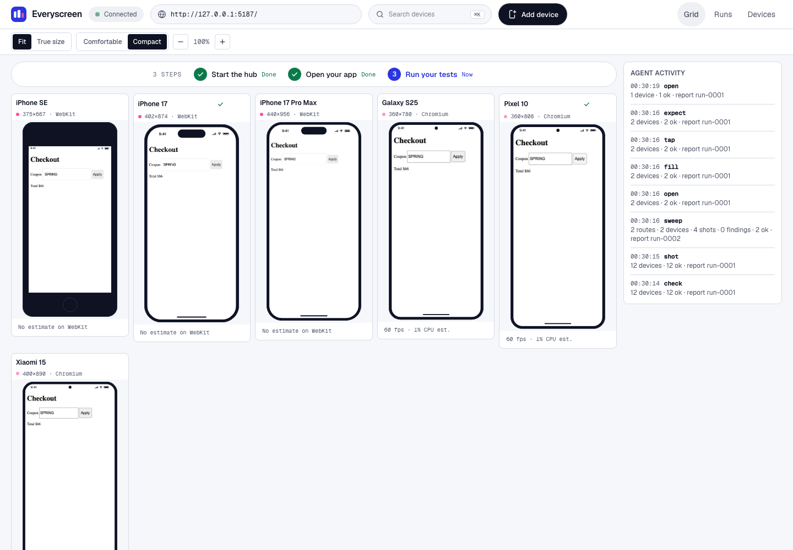
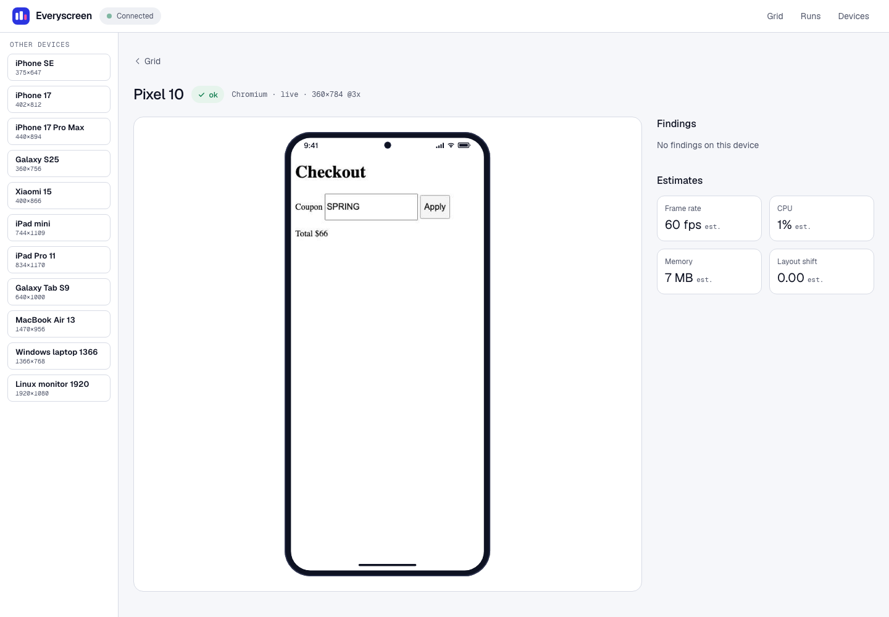

# Everyscreen

See every screen while your agent tests it.

Everyscreen runs your web app in one browser per device, on a grid of phones, tablets and laptops. Your coding agent opens, taps, types, scrolls, checks and takes screenshots on all of them at once, and gets one line back for each command.



## Install

You need Node 22.17 or newer. Add the package to your app:

```sh
pnpm add -D everyscreen
```

Install the Playwright browsers once. Everyscreen uses Chromium and WebKit:

```sh
npx playwright install chromium webkit
```

## Quick start

Start your app on its own port, then run these in your app folder:

```sh
npx everyscreen start
npx everyscreen open --url http://localhost:3000
npx everyscreen shot
npx everyscreen stop
```

`start` opens the hub on `127.0.0.1` (port 4100 by default, change it with `--port`) and one browser per device in the grid. Every command after it acts on all devices.

In a terminal, each command prints one line:

```text
12 devices · 12 ok · report run-0001
```

A `warn` finding is counted in its own column and does not fail the device. A device that has a `failed` finding, or a step that times out, is counted as failed and its line names the device:

```text
12 devices · 3 ok · 9 warn · report run-0001
1 device · 0 ok · 1 failed · report run-0003
iphone-17  failed  locator.waitFor: Timeout 10000ms exceeded.  10006 ms
```

A wrong or missing flag prints one `bad usage` line that names what to pass, and exits with code 2:

```text
bad usage · open needs --url <web address, like https://example.com>
```

When you pipe the output or pass `--json`, the command prints one JSON object with `status`, `line`, `runId` and `failures`, and never asks a question. Exit codes: `0` ok, `1` failed, `2` bad usage.

## Use it with your agent

Install the Everyscreen skill once, so your agent knows the commands:

```sh
npx everyscreen skill install
```

The default agent is Claude, which writes `.claude/skills/everyscreen/SKILL.md`. Use `--agent codex` for `.agents/skills/everyscreen/SKILL.md` or `--agent cursor` for `.cursor/skills/everyscreen/SKILL.md`. Running it again asks before it overwrites the file; pass `--yes` to overwrite without asking.

## Commands

Every command takes `--json` and `--help`. `--device <id>` runs a command on one device instead of all of them.

| Command                                                            | What it does                                                 |
| ------------------------------------------------------------------ | ------------------------------------------------------------ |
| `everyscreen start [--port <number>] [--foreground]`               | Start the hub and one browser per device, in the background  |
| `everyscreen stop`                                                 | Stop the hub and close every device browser                  |
| `everyscreen status`                                               | Show whether the hub is running and how many devices it has  |
| `everyscreen open --url <url>`                                     | Open a url on every device                                   |
| `everyscreen tap --role <role> --name <name>`                      | Tap an element by its ARIA role and accessible name          |
| `everyscreen fill --role <role> --name <name> --with <text>`       | Type into a field                                            |
| `everyscreen scroll --to top\|bottom`                              | Scroll to the top or the bottom of the page                  |
| `everyscreen check`                                                | Run the six checks on the current page                       |
| `everyscreen shot`                                                 | Save a screenshot of every device                            |
| `everyscreen expect --text <text>`                                 | Check that some text shows on every device                   |
| `everyscreen sweep --url <url>`                                    | Visit the routes of your app and save a shot on every device |
| `everyscreen devices list`                                         | List the devices in the grid                                 |
| `everyscreen devices add --name <name> --width <px> --height <px>` | Add a custom device to `everyscreen.yaml`                    |
| `everyscreen devices remove --device <id>`                         | Remove a custom device from `everyscreen.yaml`               |
| `everyscreen run [--flows <glob>]`                                 | Run YAML flows on the devices they name                      |
| `everyscreen skill install [--agent claude\|codex\|cursor]`        | Install the agent skill                                      |

Role values for `tap` and `fill` are ARIA roles, for example `button`, `link`, `textbox`, `checkbox` or `tab`.

Each command measures the page after it acts. A `failed` finding fails that command, so a page with horizontal overflow fails `open`, `tap`, `expect` and `shot` as well as `check`. A `warn` finding is counted in the reply and does not fail it.

## Flows

A flow is a YAML file in `flows/` that lists the steps and the devices to run them on. This is `flows/coupon.yaml`:

```yaml
name: Checkout with a coupon
devices: [iphone-17, pixel-10]
steps:
  - open: http://localhost:3000/checkout
  - fill: { role: textbox, name: Coupon, with: SPRING }
  - tap: { role: button, name: Apply }
  - expect: { text: "Total $66" }
```

Run every flow in `flows/`:

```sh
npx everyscreen run
```

```text
1 flow · 1 ok · report run-0001
```

Each device a flow names must be running in the hub. Leave `devices` out, or set it to `null`, to run the flow on every grid device. Use `--flows <glob>` to pick other files and `--parallel <number>` to run flows at the same time.

## Sweep your app

`sweep` starts at one url, follows the links it finds, and saves a screenshot on every device for each route, up to `--max-routes` (default 50, up to 500):

```sh
npx everyscreen sweep --url http://localhost:3000 --devices iphone-17,pixel-10 --max-routes 10
```

```text
2 routes · 2 devices · 4 shots · 0 findings · 2 ok · report run-0002
```

The line adds `warn` and `failed` counts when a route has findings of that kind. Use `--devices all` to sweep all 60 catalog devices. Use `--before <flow.yaml>` to run a flow first on each device, for example a login. Routes you list in `routes` in `everyscreen.yaml` are visited too. Screenshots go to `.everyscreen/shots/`.

## Checks

Every command runs these checks on the page after it acts:

- `overflow` (failed): an element runs past the edge of the screen
- `clipped-text` (warn): text is cut off by its box
- `safe-area` (warn): an element sits under the notch or the home bar
- `tap-target` (warn): a tap target is smaller than the minimum tap size
- `console-error` (failed): the page writes an error to the browser console
- `failed-request` (failed): a network request fails

Each finding names the device and the element. A device with a failed finding is listed in `failures` with its shot path.

## Devices

The grid shows 12 devices by default: `iphone-se`, `iphone-17`, `iphone-17-pro-max`, `galaxy-s25`, `pixel-10`, `xiaomi-15`, `ipad-mini`, `ipad-pro-11`, `galaxy-tab-s9`, `macbook-air-13`, `windows-laptop-1366` and `linux-1920`. The catalog has 60 devices in all. Run `npx everyscreen devices list` to see the grid.

Add your own device to `everyscreen.yaml`:

```sh
npx everyscreen devices add --name "Lobby kiosk" --width 900 --height 1200
```

```text
device added · lobby-kiosk
```

The new device joins the running grid at once, so `open --device lobby-kiosk` works right away. Remove it the same way:

```sh
npx everyscreen devices remove --device lobby-kiosk --yes
```

```text
device removed · lobby-kiosk
```

`devices remove` asks before it changes the file, and needs `--yes` when no terminal is attached.

The built-in catalog has Chromium and WebKit devices only. A custom device can set `browserName: firefox` in `everyscreen.yaml`, but Firefox is not tested here.

## Config file

`everyscreen.yaml` in your app folder holds custom devices, routes and the grid:

```yaml
devices:
  - name: Lobby kiosk
    width: 900
    height: 1200
routes:
  - /checkout
grid:
  - iphone-17
  - pixel-10
```

Each route starts with a single `/`. A custom device name must contain a letter or digit and be 40 characters or fewer. Width and height are 240 to 3840 pixels, and the pixel ratio is 1 to 4.

## Playwright

Everyscreen also exports the device list and a reporter for your own Playwright tests. Install Playwright in your app, since `everyscreen/test` needs `@playwright/test` as a peer:

```sh
pnpm add -D @playwright/test
```

Then use the same device grid in `playwright.config.ts`:

```ts
import { defineConfig } from "@playwright/test";
import { listDevices } from "everyscreen/playwright";

export default defineConfig({
  testMatch: "**/*.suite.ts",
  projects: listDevices(null),
});
```

Import `test` and `expect` from `everyscreen/test` in your suites. Add the default export of `everyscreen/reporter` to the `reporter` list to send each run to the hub, so it shows on the dashboard.

## Dashboard

With the hub running, open its address in a browser (for example `http://127.0.0.1:4100`). The dashboard has three pages:

- `/`: the grid of every device, live
- `/runs`: every run, and `/runs/<runId>` for one run
- `/devices`: the device list

Open `/focus/<deviceId>` for a zoomed view of one device.



## How it works

The hub is one local process bound to `127.0.0.1`. It keeps its state in `.everyscreen/` in the folder you start it from: `hub.json` (the running hub), `hub.log`, `runs/` (one file per run) and `shots/` (screenshots). Each command sends a request to the hub and prints the one-line reply.

## More

- [PROJECT.md](PROJECT.md): the problem, the goals and what is out of scope
- [CONTEXT.md](CONTEXT.md): the parts of the tool and how they fit
- [LANGUAGE.md](LANGUAGE.md): the words the code uses, and the words to avoid
- [AGENTS.md](AGENTS.md): how to build, test and change the repo
- [everyscreen.jtslabs.dev](https://everyscreen.jtslabs.dev): the project site

## License

MIT
